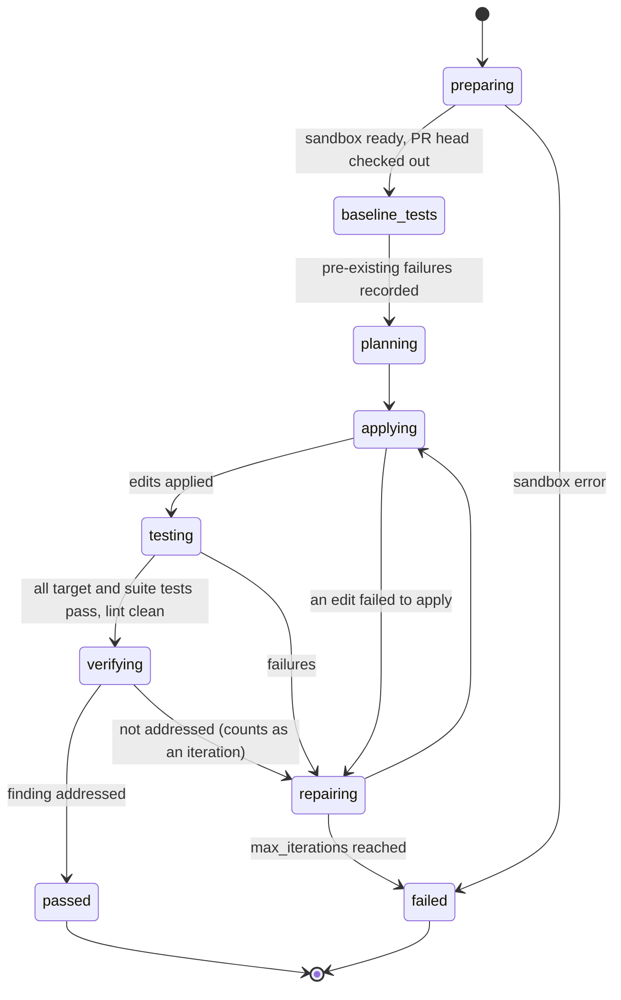

# The fix loop

This is the stand-out bar of the Coding track: *plans, writes, tests and iterates on a real repo*. A fix run turns one or more routed findings into a test-verified diff on top of the PR head.

## 1. Preconditions

- The finding's lane is `shared` or `edge` (or `blind_spot` after "Good catch"), and the category is fixable (taxonomy `fixable_default`, with the edge exceptions in [Routing](07-routing-and-triage.md) §1).
- The project has a test recipe (`config/sandbox.yaml` `recipes`). For the demo, the recipe is `python-pytest`.
- The spend estimate is under `KEEPER_AUTO_APPROVE_USD`, or the user confirmed it.

## 2. States



## 3. Steps

**3.1 Prepare (code).** Ask the sandbox runner for a workspace from the project image: the repository at the PR head (from the unpacked bundle or the imported clone), with the recipe's environment set up (`pip install -e .[test]` from a cached wheelhouse, offline). Save a **checkpoint** `cp0`.

**3.2 Baseline tests (code).** Run the recipe's `test_command` (demo: `python -m pytest -q -x --no-header -p no:cacheprovider --junitxml=report.xml`), parse the JUnit XML, and record the pre-existing failures `F0`. If `F0` is non-empty, the success criterion becomes "no new failures, and the targeted tests pass", and the UI says "2 tests were already failing on this PR".

**3.3 Plan (`fix_plan`, `deep` model, Nemotron 3 Ultra).** Input:
- the findings to fix (statement, anchor, suggestion, rationale, citations and exemplars of how P asked for this before);
- the anchored file contents (whole files if ≤ 400 lines, else ±80 lines around each anchor) and the PR diff;
- the repository map (paths, plus top-level symbols per file, from a code index built at the head);
- the test layout (test files related by name or import to the changed files);
- the house style hints (formatter and line length from `pyproject.toml`).

Output schema:
```json
{
  "plan": "Normalize the resolved path and reject paths outside root; add a regression test.",
  "edits": [
    {"path": "strata/include.py", "search": "    target = base / name\n", "replace": "    target = (base / name).resolve()\n    if not target.is_relative_to(root):\n        raise IncludeError(f\"include escapes root: {name}\", line=line)\n"}
  ],
  "new_files": [{"path": "tests/test_include_escape.py", "content": "…"}],
  "tests_to_run": ["tests/test_include_escape.py", "tests/test_include.py"],
  "risk_notes": "Python 3.9 lacks Path.is_relative_to; project supports 3.9 per pyproject."
}
```

**3.4 Apply (code).** Each `search` must occur **exactly once** in the file (whitespace-exact). On zero or several occurrences, the edit fails and the error ("search text not found in strata/include.py; closest match at line 44: …") goes to repair. New files may not overwrite existing files. Paths must stay inside the workspace. Edits to paths matching risk signals (`build_paths`, workflows) are rejected outright.

**3.5 Test (code).** Run `tests_to_run` first (fast feedback), then the full suite, then `ruff check` on the changed files restricted to the changed lines. Pass = targeted tests pass, the suite has no failures beyond `F0`, and no new ruff errors.

**3.6 Repair (`fix_repair`, `deep` model).** Input: the plan, the current diff relative to `cp0`, and the failure evidence (the pytest short summary plus up to `repair.max_failure_chars` (6,000) of the first failing test's traceback, or apply errors). Output: the same schema as plan (`edits` relative to the current state). The loop iterates up to `max_iterations` (4, counting the plan).

**3.7 Branching (FR-FIX-6).** If `branches` (default 2) > 1, the plan step produces candidates from the same checkpoint `cp0`: branch A at temperature 0.2, and branch B at temperature 0.7 with the instruction "Propose a different approach from A" (it receives A's plan text). Branches run concurrently in separate sandbox workspaces (with Token Factory Sandboxes, as branches from the same image). Selection: the first branch to pass; if both pass in the same check cycle, the smaller diff (changed lines), then the fewer new files. The losing branch is kept for inspection ("Option B also passed" or "Option B failed: …").

**3.8 Verify (`fix_verify`, `fast` model).** Input: the finding, the final diff, and the test summary. Output: `{"addresses_finding": true|false, "explanation": "…"}`. If false, it counts as a failed iteration and the explanation goes to repair (FR-FIX-13). *Why:* tests can pass with a fix that does nothing (for example a skipped test), so the verify step guards against that.

**3.9 Result.** Stored as a `fix_run` with attempts, branches, the final unified diff (relative to the PR head), the JUnit summary (passed, failed, skipped, duration), logs, and the models used per step with latency. Exports:
- **Download patch** (`git format-patch` style, authored "Keeper (suggested fix)");
- **Copy as GitHub suggestion**: for single-hunk changes within one file range, a ```` ```suggestion ```` block; otherwise the patch.

## 4. "Build both, let reality decide" (FR-FIX-9)

For `edge` findings whose cited items are all `candidate` (not validated), the UI offers **Fix both ways**. Branch A follows the lens finding; branch B follows the baseline's view of the same code (or "leave as is, add a test pinning the current behaviour" if the baseline had no finding). Both are tested and shown side by side. Whatever the maintainer chooses is recorded as a residual sample with `evidence = maintainer_choice`.

## 5. Limits and safety

| Limit | Config | Default |
|---|---|---|
| Iterations | `fix.max_iterations` | 4 |
| Branches | `fix.branches` | 2 |
| Per test run timeout | `sandbox.test_timeout_seconds` | 120 |
| Whole run timeout | `fix.run_timeout_seconds` | 900 |
| Max changed lines in a fix | `fix.max_changed_lines` | 200 |
| Network in the sandbox | `sandbox.network` | `off` |

- No secrets in the sandbox environment; the runner builds its environment from an allow-list (`PATH`, `HOME` (a temp directory), `LANG`, `PYTHONHASHSEED`).
- The model never runs shell commands. It only proposes edits and test file paths; commands come from the recipe.
- Keeper never pushes, opens PRs or comments (NFR-SAFE-1).

## 6. Events streamed to the UI

`fix.started`, `fix.sandbox.ready {provider}`, `fix.tests.baseline {passed, failed}`, `fix.plan {branch, plan, model, latency_ms}`, `fix.apply {branch, ok, errors[]}`, `fix.test.output {branch, chunk}` (throttled to 4 per second), `fix.test.result {branch, passed, failed, duration_ms}`, `fix.repair {branch, iteration, model}`, `fix.verify {branch, addresses_finding}`, `fix.completed {status, winning_branch, diff_stats}`. See [Streaming events](../05-api/03-streaming-events.md).
