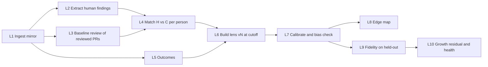
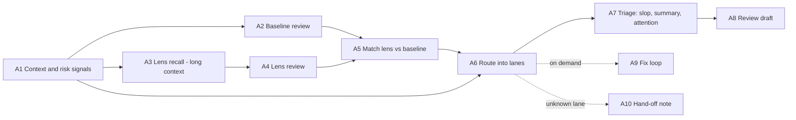

# Methodology: overview and pipeline

This section specifies **how Keeper thinks**: every algorithm, threshold and model step, and why. Each document names its config keys (in `config/*.yaml`, see [Config files](../07-configuration/03-config-files.md)) and its prompts (see [Prompt catalog](15-prompt-catalog.md)). Code MUST implement exactly this; deviations go in `docs/build-log.md` with a reason.

## 1. The mapping from the papers to Keeper

| Paper concept | In Keeper |
|---|---|
| Situation S | A pull request (diff, description, files, CI status, metadata) |
| C(S), the view from everywhere | The pinned generic review: Nemotron 3 Super with a generic reviewer prompt at temperature 0, plus ruff and bandit on changed lines |
| H(S), the view from somewhere | The maintainer's findings: inline review comments, review bodies, conversation comments, change requests, rejections, maintainer-pushed fixes |
| R(S) = H − C | One-to-one matching of H and C findings; R+ unmatched H, R− unmatched C |
| Lens L | A versioned set of lens items (attention patterns with triggers, exemplars and statistics) plus blind-spot and shared-ground items, applied by Super with retrieval |
| Four cases | Lanes `shared`, `edge`, `blind_spot`, `unknown` |
| Reality answers | Tests (minutes), CI (minutes), reverts and post-merge bugs (days to weeks) |
| Calibration | Beta-posterior hit rates per item against outcomes, plus a group-tracking bias check |
| Fidelity Test | Held-out recall of substantive maintainer findings, noise and caricature, against the baseline |
| Growth Test | Learner before and after on parallel held-out forms, unassisted |
| Growth residual G | Maintainer findings after the cutoff of lens v_k that v_k did not predict |

## 2. Two pipelines

### 2.1 The learning pipeline (per project; runs on import or on demand; results are versioned)

| Stage | Module | Models | Output tables |
|---|---|---|---|
| L1 Ingest | `keeper.ingest` | none | `pulls`, `pull_files`, `reviews`, `review_comments`, `issue_comments`, `issues`, `timeline_events`, `commits`, `check_runs`, `people` |
| L2 Human findings | `keeper.findings` | `fast` (`extract_findings`) | `findings` (source `human`) |
| L3 Baseline | `keeper.baseline` | `judge` (`baseline_review`) plus static tools | `rulers`, `findings` (source `baseline`) |
| L4 Matching | `keeper.residual` | `judge` (`match_findings`) | `finding_matches`, `residual_samples` |
| L5 Outcomes | `keeper.outcomes` | none | `outcomes`, `outcome_links` |
| L6 Lens build | `keeper.lens.build` | `deep` (`lens_items`), `judge` (`lens_card`) | `lenses`, `lens_versions`, `lens_items`, `lens_item_evidence` |
| L7 Calibration | `keeper.calibrate` | `deep` (`calibration_notes`, explanations only) | `lens_items.stats`, `lens_items.status`, `bias_checks` |
| L8 Edge map | `keeper.find` | none | `edge_map_cells` |
| L9 Fidelity | `keeper.fidelity` | as A2–A5 below, on held-out PRs; Batch API optional | `fidelity_runs`, `fidelity_cases` |
| L10 Growth | `keeper.growth` | `judge` (`match_findings`) | `growth_snapshots` |

### 2.2 The analysis pipeline (per PR; for open PRs in triage, and for any PR on request)

| Stage | Module | Model (prompt) | Cached by |
|---|---|---|---|
| A1 Context | `keeper.analysis.context` | none (code: diff parse, risk signals, OSV) | head SHA |
| A2 Baseline | `keeper.baseline` | `judge` (`baseline_review`), ruff, bandit | head SHA + ruler |
| A3 Lens recall | `keeper.lens.apply` | `fast` (`lens_recall`) over the long-context history digest; BM25 fallback | head SHA + lens version |
| A4 Lens review | `keeper.lens.apply` | `judge` (`lens_review`) | head SHA + lens version + ruler |
| A5 Match | `keeper.residual` | `judge` (`match_findings`) | the pair of finding-set hashes |
| A6 Route | `keeper.route` | none (code) | inputs hash |
| A7 Triage | `keeper.route.triage` | `fast` (`triage_signals`) | head SHA |
| A8 Draft | `keeper.review` | `judge` (`review_draft`) | routed findings hash + feedback |
| A9 Fix | `keeper.fix` | `deep` (`fix_plan`, `fix_repair`), `fast` (`fix_verify`) | not cached (each run is new) |
| A10 Hand-off | `keeper.route.handoff` | `judge` (`handoff_note`); OSV; Tavily optional | head SHA + target |

The analysis of a held-out PR (L9) is the same pipeline as A1–A6, run with the lens version under test and with exemplar retrieval restricted to before the PR.

## 3. Design decisions that run through everything

1. **Same model, same context, for baseline and lens.** Both use the `judge` model, the same PR context block and the same output schema. The only difference is the lens block, so the measured difference *is* the lens.
2. **Code computes; models judge and write.** Statistics, thresholds, routing rules, line numbers, anchors, diffs and test results are code. Models extract, match, name, review and write.
3. **Every model output is structured.** JSON Schemas live in `config/schemas/llm/`; the gateway validates and repairs.
4. **Every model output cites.** Lens findings cite items and exemplars; matches give rationales; drafts cite findings.
5. **No leakage.** Every per-PR computation that uses history filters it to `created_at < pr.created_at`. A lens version has `cutoff_at`, and Proof refuses to evaluate PRs before it.
6. **Small data, honest statistics.** Beta posteriors, bootstrap CIs and minimum supports everywhere; "not enough evidence" is a first-class state.
7. **Determinism where possible.** Temperature 0 for baseline, extraction and matching; seeds for sampling; caches keyed by content hashes.

## 4. Documents in this section

| # | Document | Specifies |
|---|---|---|
| 01 | [Situations and findings](01-situations-and-findings.md) | The finding data structure, anchors, taxonomy, severity, kinds |
| 02 | [Human findings](02-human-findings.md) | Extracting H from GitHub review data |
| 03 | [The baseline, or ruler](03-baseline-the-ruler.md) | C(S), the ruler, static tools |
| 04 | [Matching and residual](04-matching-and-residual.md) | Pairing H and C, the R partition, judge validation |
| 05 | [The lens](05-lens-representation-and-building.md) | Representation, clustering, building, the card |
| 06 | [Applying the lens](06-applying-the-lens.md) | Recall, review, citations, confidence |
| 07 | [Routing and triage](07-routing-and-triage.md) | The four lanes, risk signals, hand-offs, lens distance, slop, attention |
| 08 | [The fix loop](08-fix-loop.md) | Plan, apply, test, repair, branch, verify |
| 09 | [Outcomes, calibration and bias](09-outcomes-calibration-bias.md) | Outcomes, Beta posteriors, statuses, the group-tracking check |
| 10 | [Find: the edge map](10-find-edge-map.md) | Where the residual is valuable |
| 11 | [The Fidelity Test](11-fidelity-test.md) | Protocol, metrics, CIs, pass criteria, falsifiers |
| 12 | [The Growth Test and health](12-growth-test-and-health.md) | Practice, parallel forms, scoring, G, health states |
| 13 | [Lens versions and governance](13-lens-versions-and-governance.md) | Versions, diff, consent, export, revoke |
| 14 | [Guardrails and safety](14-guardrails-and-safety.md) | Absolute rules, injection, gaming, drift |
| 15 | [Prompt catalog](15-prompt-catalog.md) | Every prompt: role, inputs, output schema, rules |
