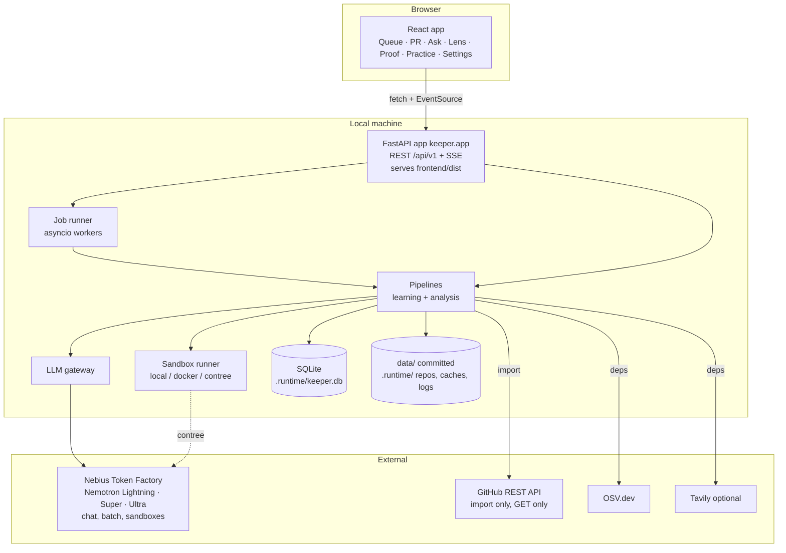

# System architecture

## 1. Local (what `./run.sh` starts)

- **One process** serves the API and the built frontend on `http://127.0.0.1:${APP_PORT}` (default 8430). In `--dev` mode, Vite serves the frontend on `FRONTEND_DEV_PORT` (5174) and proxies `/api` to the backend.
- **Jobs** run in the same process on an asyncio worker pool (`JOB_WORKERS`, 2), with CPU-bound steps (clustering, bootstrap) in a thread pool. State is persisted in `jobs` and `job_events`.
- **No message broker** and no separate worker process locally. *Rationale:* one-command startup and few moving parts. The job interface lets `JOB_RUNNER=nebius` send heavy jobs to Nebius Serverless Jobs instead.

## 2. Technology choices

| Layer | Choice | Why |
|---|---|---|
| Backend language | Python 3.11+ | The ecosystem for git, AST, statistics and pytest; the demo repository is Python |
| Web framework | FastAPI + Uvicorn | Async, OpenAPI generation (drives the frontend types), SSE via `sse-starlette` |
| Validation | Pydantic v2 | Shared request, response and LLM-output models |
| Database | SQLAlchemy 2.0 + Alembic; SQLite locally, PostgreSQL in the cloud | Zero setup locally; one code path |
| LLM client | `openai` SDK (OpenAI-compatible) pointed at Token Factory | Token Factory is OpenAI-compatible |
| HTTP | `httpx` (GitHub, OSV, Tavily) | Async, timeouts |
| Statistics | `numpy`, `scipy`, `scikit-learn` (TF-IDF, agglomerative clustering) | Standard, offline |
| Search | `rank-bm25` | BM25 fallback for recall |
| Git | the `git` CLI via `subprocess` (wrapped in `keeper.sources.git`) | Exact behaviour, bundles, blame |
| Static tools | `ruff`, `bandit` (pinned) | The baseline's tools |
| Frontend | React 19 + TypeScript (strict) + Vite | Fast build; typed |
| Styling | Tailwind CSS v4 with CSS-variable design tokens | Fluid utilities, container queries |
| UI primitives | Radix UI (dialog, popover, tooltip, tabs, dropdown, toast, scroll-area) | Accessible behaviour |
| Data fetching | TanStack Query v5 | Caching, invalidation, retries |
| Routing | React Router v7 (data router) | Nested routes, deep links |
| Markdown | `react-markdown` + `remark-gfm` + `rehype-sanitize` | Safe rendering of model and PR text |
| Diff parsing | `parse-diff` | Unified diff → structure; the renderer is Keeper's own `DiffView` |
| Syntax highlighting | `shiki` (lazy-loaded, fine-grained bundle for Python, TOML, YAML, Markdown) | Accurate highlighting; loaded on demand |
| Icons | `lucide-react` | Consistent, tree-shaken |
| Fonts | `@fontsource-variable/inter`, `@fontsource-variable/jetbrains-mono` (self-hosted) | Works offline |
| Tests | pytest, hypothesis; Vitest + Testing Library; Playwright + axe-core | — |

## 3. Request flows

### 3.1 Opening the Queue
`GET /api/v1/projects/{pid}/queue` → reads `analyses` (live preferred over snapshot) and joins `pulls`, `routed_findings` counts and `fix_runs` status → returns rows. There are no model calls.

### 3.2 Refreshing the queue (live)
`POST /api/v1/projects/{pid}/queue/refresh` → creates a `triage` job → for each open PR without an analysis at its head SHA under the current ruler and lens version: A1–A8 (concurrency-limited) → each PR emits `analysis.updated` → the frontend invalidates the queue query.

### 3.3 Fix and test
`POST /api/v1/projects/{pid}/pulls/{n}/fixes {finding_ids}` → a cost estimate is checked against auto-approve (otherwise `402 confirmation_required` with the estimate; the UI shows a confirm dialog and resends with `confirm: true`) → a `fix` job → the sandbox runner → events stream to `GET /api/v1/jobs/{id}/events`.

### 3.4 Ask
`POST /api/v1/chat/threads/{tid}/messages` (an SSE response) → the assistant loop (Super with tools) → tools call internal services, never HTTP → deltas, tool steps and cards stream back.

## 4. Configuration layering

1. Code defaults (minimal, only where a value is structural).
2. `config/*.yaml` (committed, non-secret, tunable).
3. `.env` and the process environment (secrets, model IDs, ports, modes). Environment variables override `.env`.
4. `settings_overrides` (the user-editable subset, from the UI).

`keeper.config.load()` merges these into one typed `Settings` object (pydantic-settings), validated at startup. `GET /api/v1/settings` returns the effective non-secret values and booleans for secrets ("configured": true or false).

## 5. Modes

| Mode | Set by | Behaviour |
|---|---|---|
| `demo` (default) | `KEEPER_MODE=demo` | Loads the demo project; `demo_now` from the manifest; personas available; snapshot loaded |
| `workspace` | `KEEPER_MODE=workspace` | No demo; projects come from imports |
| no-key | No `NEBIUS_API_KEY` (and the provider is not `fake`) | Every view works from the snapshot; live actions are disabled with an explanation |
| cloud | `KEEPER_AUTH_MODE=access_code` | Sign-in page; secure cookies; rate limits; import disabled unless `IMPORT_ALLOWED=true` |

## 6. Cloud (competition) architecture

See [Nebius architecture](../09-deployment/01-nebius-architecture.md). In short: the same container runs as a Nebius Serverless Endpoint; heavy jobs optionally go to Nebius Serverless Jobs; PostgreSQL and Object Storage are optional; all inference goes to Token Factory.
