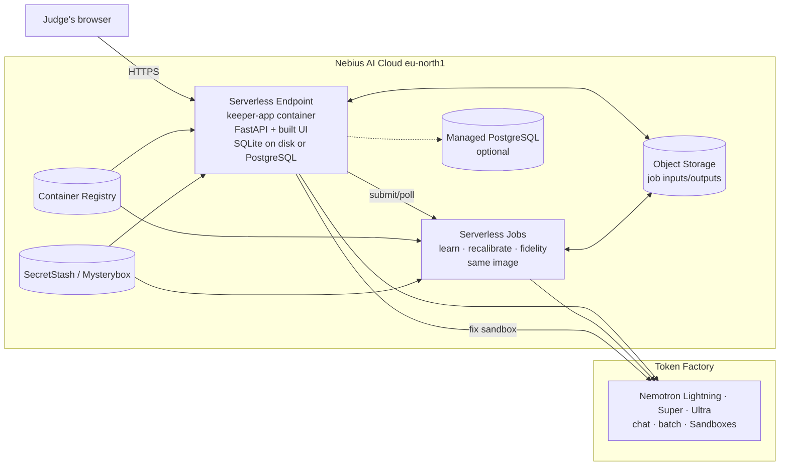

# Nebius architecture (competition deployment)

Local is the main development target. For the competition, the same container runs on Nebius so judges get a URL that works until **15 Dec 2026, 12:00 PST**.

## 1. Compliance

Keeper meets "runs on Nebius" both ways (Hackathon ref 03 §1): every model call goes to **Nebius Token Factory** (NVIDIA Nemotron) at runtime, **and** the app runs on **Nebius AI Cloud** (a Serverless Endpoint, with optional Serverless Jobs). Either alone would be enough; both together score better on Technological implementation.

## 2. Diagram

## 3. Components

| Component | Choice | Why |
|---|---|---|
| App | One Serverless Endpoint, CPU (`cpu-d3`, `4vcpu-16gb`), public HTTPS, container port 8430 | The same single-process app as local; ~5 min to create; stoppable |
| Container image | `infra/docker/Dockerfile`: multi-stage (Node build of the frontend → Python slim runtime with the backend, `frontend/dist`, `data/`, `config/`, the wheelhouse); non-root user; `linux/amd64` | `data/` is baked into the image, so the endpoint needs no import |
| Database | SQLite on the endpoint's disk (default; the demo is read-mostly) or Managed PostgreSQL (`DATABASE_URL`) for durability across redeploys | SQLite is simpler. PostgreSQL survives redeploys and holds judges' threads. Recommended for judging. |
| Heavy jobs | `JOB_RUNNER=nebius` for `learn`, `recalibrate` and `fidelity` | Visible use of Serverless Jobs; keeps the endpoint responsive |
| Job data | Object Storage bucket | Inputs and outputs of remote jobs |
| Sandbox | Token Factory Sandboxes (`contree`) if access is granted. Otherwise `local`, because Docker is not available inside the endpoint container; the container itself is the isolation boundary. | Stated in the README and Settings |
| Secrets | SecretStash (CLI `mysterybox`) → `--env-secret` | No secrets in the image or in `--env` |
| Access | Keeper's access-code sign-in (`KEEPER_AUTH_MODE=access_code`), with codes in the testing instructions | Browser-friendly (the endpoint's token auth suits API clients, not browsers) |
| Cost controls | `KEEPER_SPEND_CAP_USD` per day, `API_RATE_LIMIT_PER_MINUTE`, confirmations, import disabled (`IMPORT_ALLOWED=false`) | The Token Factory balance has no cap of its own; HTTP 402 when empty |

## 4. Cloud-specific behaviour

| Setting | Local | Cloud |
|---|---|---|
| `APP_HOST` | 127.0.0.1 | 0.0.0.0 |
| `KEEPER_AUTH_MODE` | none | access_code |
| `OPEN_BROWSER` | true | false |
| `API_DOCS` | true | false |
| `IMPORT_ALLOWED` | true | false (judges can't start large imports) |
| `JOB_RUNNER` | local | nebius (or local if the job runner's service account isn't set up) |
| `KEEPER_SPEND_CAP_PERIOD` | month | day |
| `LOG_LEVEL` | INFO | INFO, JSON format (`LOG_FORMAT=json` is set automatically when not a TTY) |

## 5. Budget (estimate for the judging window)

| Item | Estimate |
|---|---|
| Endpoint, CPU 4 vCPU / 16 GB, 30 Oct – 15 Dec | Check current Compute pricing; participants report ≈ $56 for the smallest CPU preset for 1–15 Dec, so budget roughly 3× that for the full window at a larger preset, or use the smallest preset that passes the smoke test |
| Managed PostgreSQL (smallest) | Per current pricing; optional |
| Token Factory usage by judges | With a $10/day cap: ≤ $460 worst case; typical use is far lower (an analysis ≈ $0.02, a fix ≈ $0.05–0.15, an Ask answer ≈ $0.01) |
| Serverless Jobs | Seconds to minutes per run; small |

Record actual figures in [Judging operations](03-judging-operations.md) §3.
